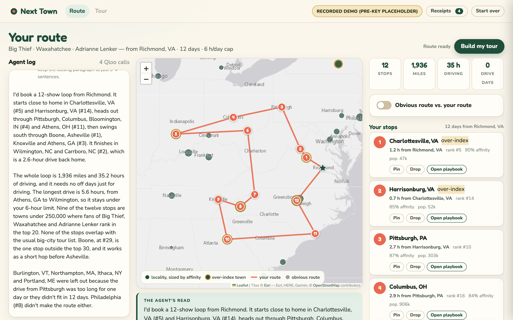
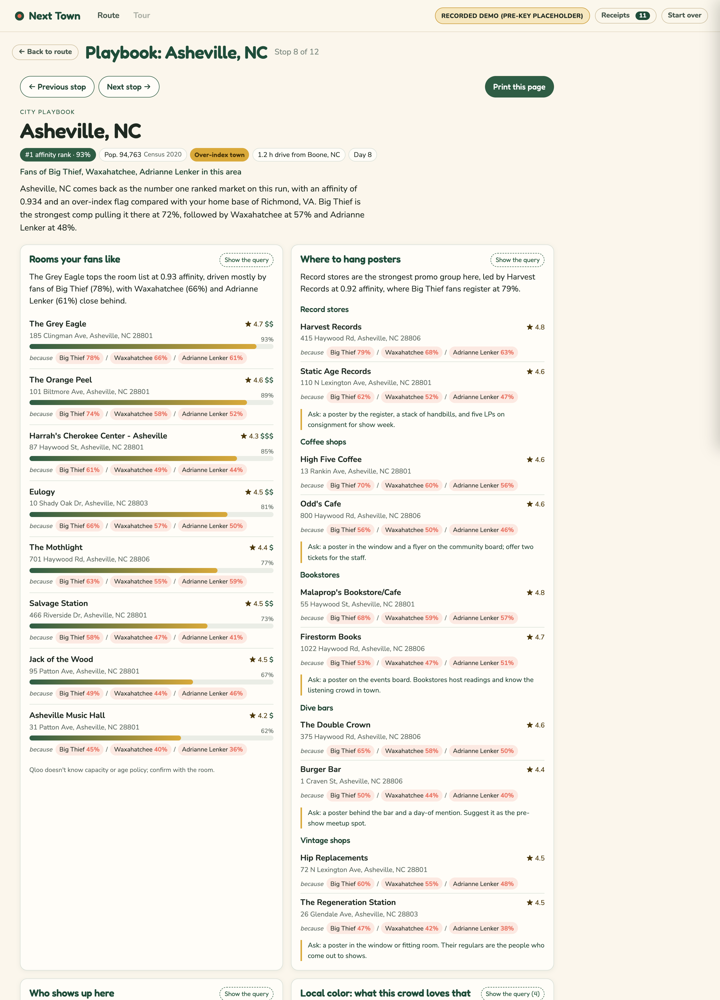
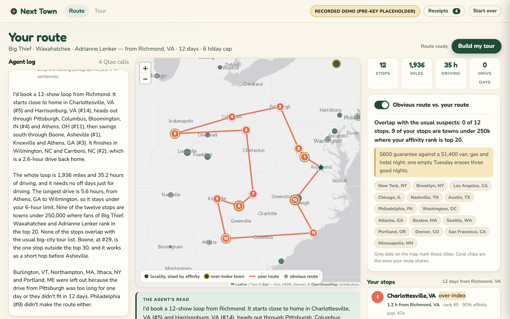
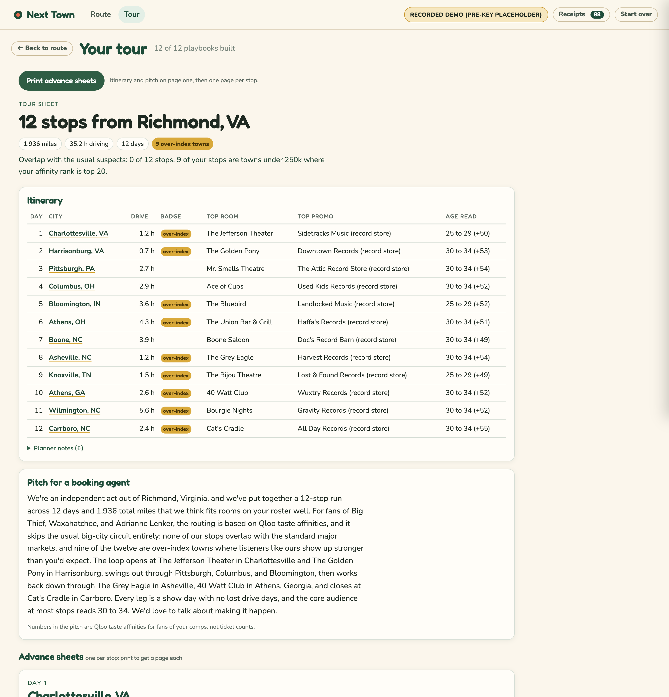

# Next Town

**Find the towns that already love you.**

Next Town is a tour-routing agent for independent acts. Tell it one to three artists you sound like, your home city, how many days you have (3 to 21), and how long you'll drive in a day (2 to 10 hours). It asks Qloo where fans of those artists rank highest across the US. It flags the small towns where that audience is strongest, plans a loop you can actually drive, and writes a one-page playbook for every stop. Every Qloo call it makes is listed with its exact URL.

Built by Rachel Selbrede for the Qloo Agentic Hackathon.

## Try it

**Try it:** `<LIVE_URL>` (the Cloudflare Worker URL; fill in after `npm run deploy`) · **Source:** `<REPO_URL>`

Click **Try it with Hollow Pines**. That's the whole setup.

Hollow Pines is a fictional band: an indie-folk trio from Richmond, VA, with twelve days to tour and a six-hour daily drive cap. The comps are real (Big Thief, Waxahatchee, Adrianne Lenker). The band is not, and the sample card says "fictional band" right on it. The button replays a recorded run of the real agent, so it needs no key, costs nothing, and plays the same way for every judge. **Skip ahead** jumps straight to the finished route.

> Until the Qloo key arrives, every Qloo answer in the sample is a hand-authored placeholder in the response shape the Qloo docs describe. The header pill says so: "Recorded demo (pre-key placeholder)". See [Data](#data) and [Honest limits](#honest-limits).

| The route, with the agent log and the agent's read | A city playbook |
| --- | --- |
|  |  |
| **Obvious route vs. your route** | **Build my tour** |
|  |  |

More in [docs/screenshots/](docs/screenshots/), including the Receipts drawer and the phone layout.

## What it does

- **Routes a loop.** The agent resolves your comps in Qloo, ranks the 50 US localities where fans of those comps rank highest, and plans a loop from home that respects your drive cap. The agent log streams on the left while the map fills in. Dots are sized by affinity. Hover one for its rank, population, and a "because" line naming the comps behind it.
- **Over-index badges.** A town gets a gold badge when its 2020 Census population is under 250,000 and its affinity rank is 20 or better. The planner reaches for those towns first.
- **Obvious-route comparison.** One switch, "Obvious route vs. your route", puts fifteen usual-suspect big markets on the map as grey dots and counts the overlap. For the sample it reads: "Overlap with the usual suspects: 0 of 12 stops. 9 of your stops are towns under 250k where your affinity rank is top 20."
- **Pin, drop, add.** Change the loop and it re-plans in your browser right away, with no server trip. "Judgment calls the planner made" lists every choice in plain words, like why Burlington, VT was skipped.
- **Playbooks with four cards.** Open any stop and you get:
  - *Rooms your fans like*, ranked by affinity.
  - *Where to hang posters*: record store, coffee shop, bookstore, dive bar and vintage shop, up to two of each, with a suggested ask for each kind.
  - *Who shows up here*: age and gender affinity bars, plus suggestions that are labeled as suggestions.
  - *Local color*: brands and TV shows this market's fans like more than your home market's fans do, shown as a difference in points, or "new" when home never ranked them.
- **Explainability chips.** Every room and shop carries chips like "because Big Thief 78% / Waxahatchee 66% / Adrianne Lenker 61%", taken from Qloo's explainability output. Every card has a **Show the query** button.
- **Receipts drawer.** Every Qloo call in order: the tool, path, parameters, live or demo, HTTP status, timing, result count, top three results, the exact URL, and **Copy as curl**. The curl line reads your key from `$QLOO_API_KEY`. The key is never shown.
- **Build my tour.** Builds a playbook for every stop, writes a short pitch for a booking agent, and lays out an itinerary table (day, city, drive, badge, top room, top promo, age read) plus one advance sheet per stop. **Print advance sheets** puts the itinerary and pitch on page one, then one page per stop.

Your tour is saved in the browser, so a reload offers **Resume last tour**.

## How Qloo is used

Every request goes to `https://hackathon.api.qloo.com` with the `X-Api-Key` header, through one client (`src/qloo.ts`). Claude never writes a URL. A tool takes small inputs (a name, a list of entity ids, a city) and `src/queries.ts` builds the parameters from fixed constants. Same inputs, same request, every time.

`src/queries.ts` has eight query builders. The app sends seven query shapes, because local color runs once for brands and once for TV shows. `scripts/verify.mjs` checks all nine, including the two only it uses.

| Call | Made by | Endpoint | Key parameters | What it grounds |
| --- | --- | --- | --- | --- |
| `resolve_act` | Claude tool | `GET /search` | `query`, `types=urn:entity:artist` (`urn:entity:person` for comedy), `take=5` | Each comp becomes a Qloo entity id. The tool keeps up to three candidates of the right type; the agent picks the exact or near name match, then the most popular. |
| `rank_markets` | Claude tool | `GET /v2/insights` | `filter.type=urn:entity:locality`, `signal.interests.entities=<comp ids>`, `filter.geocode.country_code=US`, `take=50`, `feature.explainability=true` | The ranked markets: map dots, over-index badges (joined with Census population), the per-comp "because" line, and the only towns the planner may route through. |
| `find_rooms` | playbook | `GET /v2/insights` | `filter.type=urn:entity:place`, `filter.location.query=<City, ST>`, `filter.location.radius=15000`, `filter.tags=<venue tag ids>`, `operator.filter.tags=union`, `signal.interests.entities`, `sort_by=affinity`, `take=8`, `feature.explainability=true` | *Rooms your fans like*. Venue tags are music venue, concert hall and live-music bar (comedy club for comedy). |
| `find_promo_partners` | playbook | `GET /v2/insights` | The same place filter with the record store, coffee shop, bookstore, dive bar and vintage tag ids, plus `diversify.by=properties.subtype`, `diversify.take=2`, `take=12` | *Where to hang posters*, grouped by subtype or tag, two per kind. |
| `who_shows_up` | playbook | `GET /v2/insights` | `filter.type=urn:demographics`, `signal.interests.entities`, `signal.location.query=<City, ST>`, `signal.location.radius=25000` | *Who shows up here*: age and gender affinities averaged across the comps, the strongest age band, and one to three suggestions. |
| `local_color` (4 calls) | playbook | `GET /v2/insights` | `filter.type=urn:entity:brand` or `urn:entity:tv_show`, `signal.interests.entities`, `signal.location.query`, `signal.location.radius=25000`, `take=20`; each type once for the stop and once for home | *Local color*: the stop's affinity minus home's affinity for the same entity, top five per type. |
| `find_tags` | `scripts/verify.mjs` | `GET /v2/tags` | `filter.query`, `take=10` | Replaces the guessed place-tag ids in `data/tags.json` with ids the API returns. |
| `openers_to_ask` | `scripts/verify.mjs` | `GET /v2/insights` | `filter.type=urn:entity:artist`, `signal.interests.entities`, `signal.location.query`, `signal.location.radius=25000`, `filter.popularity.max=0.6`, `filter.exclude.entities=<comp ids>`, `bias.trends=medium`, `take=10`, `feature.explainability=true` | Nothing in the app yet. The shape is built and checked, but no card uses it. |

**How many calls.** Planning makes one search per comp plus one ranking: four for the sample. A playbook makes seven, all at once. When the stop is your home city, the repeated home calls collapse to one each by canonical URL, so it makes five. Planning the sample and building all twelve playbooks comes to 88 calls, and the Receipts drawer shows every one. The pitch makes no Qloo calls.

**Explainability.** With `feature.explainability=true`, each result carries `query.explainability.by_entity`: how much each comp contributed. `normalize()` in `src/qloo.ts` turns that into the chips. That is the shape the fixtures use; `normalize()` also accepts a map under `signal.interests.entities`, and `npm run verify` prints the real shape once the key works.

**The over-index rule** is `C.OVER_INDEX_POP` (250,000) and `C.OVER_INDEX_RANK` (20) in `src/queries.ts`, mirrored in `src/routing.ts`.

## How the agent works

- **Claude tool loop** (`src/agent.ts`). A small streaming loop on the Messages API through `@anthropic-ai/sdk`. No framework. Three tools with strict JSON schemas: `resolve_act`, `rank_markets`, `plan_route`. Adaptive thinking with summarized display, effort "medium", at most 8 turns. Tool calls from one turn run in parallel, and their results go back together. The system prompt (`src/copy.ts`) sets the order (resolve each comp, rank once, route once, close in three or four sentences) and the honesty rules.
- **Claude picks the step; code picks the parameters** (`src/queries.ts`, `src/canonical.ts`). `canonicalUrl()` lower-cases and sorts the parameter keys, `idList()` sorts and de-duplicates entity ids, and cities are normalized to "City, ST". So comp order and typing never change what Qloo is asked. The canonical URL is the fixture key and the in-request cache key. The receipt shows the URL exactly as it was sent.
- **`plan_route` makes no Qloo call.** It routes only through the localities the last `rank_markets` returned, so the agent can't add a town Qloo didn't rank. If the agent passes days or a drive cap out of range, the tool uses what you asked for. `src/routing.ts` is pure: straight-line miles at 55 mph; a leg over the cap costs drive days; greedy nearest-neighbour that prefers pinned towns, then over-index towns; up to six 2-opt sweeps; a pass that fills open days; and a note for every judgment call. `public/js/routing.js` is a plain-JS copy for the browser, and a test feeds both the same inputs and checks they agree.
- **SSE events** (`src/sse.ts`, `src/index.ts`). `POST /api/plan` streams `meta`, then the agent's `turn`, `thinking`, `text`, `tool_call` and `tool_result`. The tools add `comps`, `receipt`, `markets` and `route` as they finish, and `done` carries the closing paragraph. `POST /api/city` streams `meta`, `status` lines, one `receipt` per Qloo call, one `playbook`, then `done`. `POST /api/pitch` returns JSON. `GET /api/health` returns `{ ok, qloo, model, claude, recorded }`.
- **Card copy and the pitch** (`src/city.ts`, `src/pitch.ts`). Each playbook gets one structured-output call (`client.messages.parse` with a JSON schema, effort "low"). Claude sees only the fields it may cite, and the prompt forbids anything it can't trace to them. The pitch is one short call. Both fall back to templated copy built from the same data, so a card is never empty and never says more than the data does. The itinerary rows are plain data; no model touches them.
- **Recorded replay** (`src/recorded.ts`, `scripts/record.mjs`). The record script runs the real handler in-process with live Claude and saves every event. The server replays it at 250 to 600 ms per event (60 ms per streamed text or thinking chunk), about twenty seconds in all. `?fast=1` drops the delays; that's the **Skip ahead** button. Playbooks and the pitch replay from the same recording.

## Modes

The pill in the header always says where the answers come from.

- **Recorded demo.** The sample button sends `scenarioId: "hollow-pines", recorded: true`, and the server replays the recording. It also replays it for the sample whenever Claude isn't configured. The pill reads "Recorded demo (pre-key placeholder)" while any Qloo fixture is hand-authored, and "Recorded demo (captured <date>)" once `npm run record` has captured live Qloo responses. The recorded pitch is used only while the loop is unchanged.
- **Live.** Needs `ANTHROPIC_API_KEY` on the Worker, or the Node dev server, which can also use an `ant auth login` profile. Then a **Run it live** link appears on the landing page (same Hollow Pines inputs, real agent), and the "Or route your own act" form works. The pill reads "Live: Qloo + Claude", or "Live Claude · Qloo fixtures" while Qloo is in demo mode. Without Claude, the form gets a 503: "Live mode needs an Anthropic key; try the sample."
- **Qloo live or demo.** `QLOO_MODE=auto` (the default) uses the live API when `QLOO_API_KEY` is set and the fixtures when it isn't. In demo mode, `src/demo/resolver.ts` looks each request up in `fixtures/qloo/` by canonical URL. A request with no fixture shows up in the receipts as HTTP 404 ("no demo fixture for this request"). Nothing is made up to fill the gap.

## Data

- **`data/us-places.json`**: 6,750 US incorporated places and Census-designated places with 5,000 or more people, as `{ label, name, state, population, lat, lon }` (710 KB). Built on 2026-10-10 by `scripts/build-places.mjs` from the Census 2020 Gazetteer place file, the Vintage 2023 population estimates file (`sub-est2023.csv`), the TIGERweb 2020 CDP layer, and the 2020 county Gazetteer (for the five New York City boroughs). The exact URLs and every cleaning rule are in [data/README.md](data/README.md). No number in the file is typed by hand. `src/places.ts` matches labels forgivingly ("Saint Louis" and "St. Louis", "Portland, Maine", "washington dc").
- **`data/obvious-route.json`**: the fifteen usual-suspect markets (New York, Brooklyn, Los Angeles, Chicago, Nashville, Austin, Philadelphia, Washington DC, Atlanta, Boston, Seattle, Portland OR, Denver, San Francisco, Minneapolis). Hand-maintained, not from Qloo, used only for the comparison.
- **`data/tags.json`**: place-tag ids for the venue and promo groups. Marked `_handAuthored: true`: best guesses until `npm run verify` rewrites them from `GET /v2/tags`.
- **`data/scenarios/hollow-pines.json`**: the sample band, its request, placeholder comp ids, the 50 markets the placeholder ranking holds, and the 13 cities that get playbooks.
- **`fixtures/qloo/`**: 74 hand-authored placeholder responses, one per canonical URL the sample needs: three searches, one locality ranking, and five insights calls for each of 14 cities (the 13 playbook cities plus Richmond, the home market). Every file says `_handAuthored: true, _captured: null`, and every one follows the response shape in the Qloo docs. The venue and shop names were picked by hand to be plausible for each town. Every affinity, rank and demographic number is a placeholder, not Qloo data. `scripts/scaffold-fixtures.mjs` writes the skeletons from the same query builders the server uses, and `scripts/bundle-fixtures.mjs` bundles them into `src/demo/fixtures.generated.ts`, because a Worker has no filesystem to read them from.
- **`fixtures/scenarios/hollow-pines/`**: the recording the sample replays. `plan.jsonl` holds 165 events from one live Claude run against the placeholder fixtures. There is a `city-<slug>.json` playbook for each of the 12 stops plus Louisville, and a `pitch.json`. `scripts/record.mjs` writes them and regenerates `src/recorded.generated.ts`.

**When the Qloo key arrives** (step by step in [docs/DEPLOY.md](docs/DEPLOY.md)):

1. `npm run verify` runs each query shape once against the real API: search, tags for every group term, locality ranking, rooms, promo, demographics, brands, TV shows, openers. It prints the status, result count, first entity's field names and explainability shape for each, says whether `urn:entity:locality` and `urn:demographics` work, and rewrites `data/tags.json`.
2. `npm run record` runs the sample end to end, overwrites the matching `fixtures/qloo/*.json` with the live responses (`_handAuthored: false`, `_captured: <date>`), re-bundles them, and re-records the replay. The pill changes on its own. `node scripts/record.mjs --dry-run` shows what it would do without calling anything.

## Honest limits

- Qloo gives aggregate taste affinities for fans of your comps in an area. That isn't a headcount, and it says nothing about any one person. The app says "fans of your comps around Asheville", never "people in Asheville".
- No claims about capacity, age policy, ticket sales, guarantees or draw. The prompts forbid them, the templated copy never makes them, and every playbook and advance sheet says to confirm capacity and age policy with the room.
- The route is a starting point, not a booking. Distances are straight-line miles at 55 mph, not road routes. It knows nothing about venue calendars, holds or which nights are weekends. The planner lists its judgment calls so you can disagree with them.
- Population is the 2020 Census count for the place itself, not the metro around it.
- Until the Qloo key arrives, every Qloo number in the demo is a placeholder, including the ranking that puts Asheville first. The sample shows how Next Town works. It doesn't yet show what Qloo says about these three artists. The query shapes follow the Qloo docs but haven't run against the live API yet; `npm run verify` is that check.
- Also until then, only the sample's 14 cities have fixtures. A comp outside the sample isn't found (its search is a 404 receipt, and the agent says so). A town outside them gets a playbook page that says plainly the demo has no recorded Qloo answers for it, with its 404 receipts, and Claude isn't asked to write about data that isn't there. Dropping a stop in the sample, for example, can pull in Lancaster, PA. Restore the stop and the loop goes back to what it was.
- The comedy path (people instead of artists, comedy-club tags) is in the code but has no sample or fixtures yet.
- The replay is one real Claude run saved word for word, so its narration is exactly what the model said that time.

## Run it locally

Node 22.18 or newer. I built it on Node 26, which runs the TypeScript in `src/` directly, so there's no build step for local work. (Wrangler bundles it for the Worker.)

```bash
npm install
npm run dev          # http://localhost:8787 under Node, same handler as the Worker
npm run dev:worker   # the same app under wrangler; copy .dev.vars.example to .dev.vars first
npm test             # Node's built-in test runner, no test dependencies
npm run typecheck    # tsc --noEmit
```

`npm run dev` gets Claude from `ANTHROPIC_API_KEY` or your `ant auth login` profile. `PORT=9000 npm run dev` changes the port. With no keys at all, the sample still works.

Environment: `ANTHROPIC_API_KEY`, `QLOO_API_KEY`, `QLOO_MODE` (`auto`, `live` or `demo`), `QLOO_BASE_URL` (defaults to `https://hackathon.api.qloo.com`), `MODEL` (defaults to `claude-opus-5-5`).

Other scripts:

| Command | What it does |
| --- | --- |
| `npm run fixtures` | Scaffolds any missing fixture skeletons for the sample, then re-bundles `fixtures/qloo`. |
| `npm run verify` | Checks every query shape against the live Qloo API and rewrites `data/tags.json`. Without a key it prints the plan and calls nothing. |
| `npm run record` | Re-records the sample (`--dry-run`, `--no-fixtures`, `--module-only`). Spends real Claude tokens. |
| `npm run build:static` | Builds the static mirror into `site/`. |
| `node scripts/build-places.mjs` | Rebuilds `data/us-places.json` from the Census files. |
| `node scripts/screenshots.mjs [url]` | Retakes `docs/screenshots/` with headless Chrome. |

## Deploy

One Cloudflare Worker serves `public/` as static assets and `src/index.ts` as the API (`wrangler.jsonc`). `npm run deploy` runs `wrangler deploy`. The secrets are `ANTHROPIC_API_KEY` and `QLOO_API_KEY`, set with `npx wrangler secret put`. The ten-minute setup, and what to run the day the Qloo key arrives, are in [docs/DEPLOY.md](docs/DEPLOY.md).

There's also a static mirror for GitHub Pages. `npm run build:static` copies `public/` to `site/` and bundles the same Worker handler (`src/static-entry.ts`) to run inside the page, with no keys and Qloo in demo mode. The sample works end to end there; routing your own act points you to the hosted Worker. `.github/workflows/pages.yml` runs the tests and the type check, builds the mirror, and publishes it on every push to `main`.

## Repo layout

```
src/
  index.ts               Worker entry: /api/health, /api/plan, /api/city, /api/pitch, static assets
  agent.ts               the streaming Claude tool loop
  app.ts                 request validation and the plan run: prompt, tools, turn budget
  tools.ts               resolve_act, rank_markets, plan_route, and receipts
  queries.ts             every Qloo query shape, built from small inputs
  canonical.ts           canonical URLs (fixture key, cache key) and city normalization
  qloo.ts                Qloo client (live or demo), entity normalization, explainability
  city.ts                the playbook: seven parallel calls, promo groups, demographics, local color, card copy
  pitch.ts               the booking-agent pitch and its templated fallback
  routing.ts             the loop planner and the obvious-route comparison
  places.ts              Census place lookup
  recorded.ts            replay of the recorded sample
  recorded.generated.ts  the bundled recording (written by scripts/record.mjs)
  copy.ts                every prompt, in one place
  sse.ts                 Server-Sent Events helpers
  types.ts               shared types and event payloads
  static-entry.ts        the same handler, built for the static mirror
  demo/                  fixture resolver and the bundled fixtures (written by scripts/bundle-fixtures.mjs)
public/
  index.html, styles.css, cards.css, print.css
  js/app.js              state machine for the four screens, saved to localStorage
  js/trace.js            the agent log
  js/map.js              Leaflet map
  js/route.js            route rail: totals, obvious toggle, pin, drop, add, judgment calls
  js/routing.js          plain-JS copy of src/routing.ts
  js/playbook.js         the four cards and "Show the query"
  js/tour.js             itinerary, pitch, advance sheets
  js/receipts.js         the Receipts drawer
  js/stream.js           older SSE reader for /api/run (app.js doesn't load it)
data/                    us-places.json, obvious-route.json, tags.json, scenarios/, README.md (sources)
fixtures/qloo/           placeholder Qloo responses, keyed by canonical URL in index.json
fixtures/scenarios/hollow-pines/   the recorded sample
scripts/                 dev-node, build-places, scaffold-fixtures, bundle-fixtures, verify, record, build-static, screenshots
tests/                   agent, canonical, city, demo-behavior, places, qloo, resolver, routing, tools
docs/                    CONTRACT.md (the build contract), DEPLOY.md, SUBMISSION.md (Devpost text), screenshots/
.github/workflows/       pages.yml (the static mirror)
```

The frontend is plain ES modules, with no bundler and no framework. Leaflet 1.9.4 from cdnjs is the only external script. Map tiles are Esri's keyless Light Gray Canvas, because CARTO now watermarks keyless tiles. Fonts are Fredoka and Nunito from Google Fonts. Light and dark follow your system, and on a phone it's one column.

## License

MIT. See [LICENSE](LICENSE).
