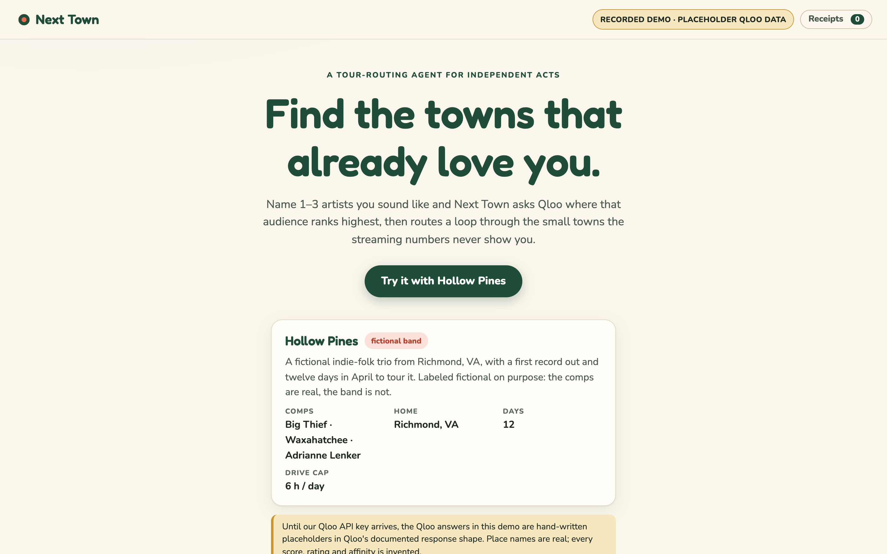
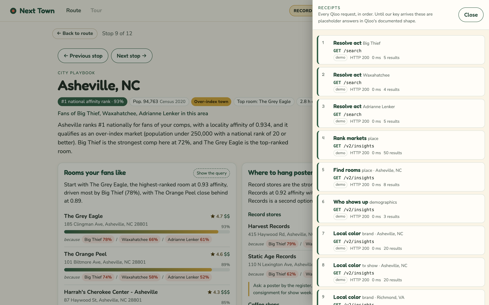

# Next Town

**Find the towns that already love you.**

Next Town is a tour-routing agent for independent acts. Tell it one to three artists you sound like, where you live, how many days you have, and how far you will drive in a day. It asks Qloo where fans of those artists rank highest across the US, flags the small towns where that audience over-indexes, plans a drivable loop, and builds a one-page playbook for every stop. Every Qloo request is listed with its exact URL, so you can check its work.

Built for the Qloo Agentic Hackathon by Rachel Selbrede.

## Try it

- **Demo:** https://rachelselbrede.github.io/next-town/ (the recorded sample, no keys needed)
- **Live agent:** `<WORKER_URL>` (filled in after the Cloudflare deploy, see [docs/DEPLOY.md](docs/DEPLOY.md))
- **Code:** https://github.com/rachelselbrede/next-town

Click **Try it with Hollow Pines**. Hollow Pines is a fictional indie-folk trio from Richmond, VA, labeled fictional on purpose: the comps (Big Thief, Waxahatchee, Adrianne Lenker) are real, the band is not. One click replays a recorded run of the agent, so the sample plays the same for every judge. Hit **Skip ahead** to jump to the finished route.

> **Honest note about the data.** Until our Qloo API key arrives, the Qloo answers in this demo are hand-written placeholders in Qloo's documented response shape. Place names are real; every score, rating and affinity is invented. The header pill says which kind of data you are looking at. The section [Placeholders, live data, and the Qloo data rule](#placeholders-live-data-and-the-qloo-data-rule) explains how the switch to live data works.

## Screenshots

| | |
| --- | --- |
|  |  |
|  |  |
|  |  |

## What it does

- **Routes a loop.** The agent resolves your comps in Qloo, asks for the venues across the US that fans of those comps rank highest (one per city), and plans a loop from home that respects your daily drive cap. The agent log streams on the left while the map fills in.
- **Over-index badges.** A town gets a gold badge when its 2020 Census population is under 250,000 and its affinity rank is 20 or better. Those towns go into the loop first.
- **Obvious-route comparison.** A toggle shows the fifteen usual-suspect streaming markets as grey dots and says how many of your stops overlap. For the sample, none do.
- **Pin, drop, add.** Pin a stop and it stays put. Drop one or add a ranked town, and the loop re-plans in the browser at once.
- **Playbooks with four cards.** Click any stop: rooms your fans like, where to hang posters (record store, coffee shop, bookstore, dive bar, vintage shop), who your comps draw (age and gender affinity bands), and local color (brands and TV shows this market's fans love more than the home market's).
- **Because chips.** Every room and shop carries "because Big Thief 78% / Waxahatchee 66%" chips, built from Qloo's explainability output. Every card has a **Show the query** button.
- **Receipts drawer.** Every Qloo request in order: tool, path, parameters, status, timing, top results, the exact URL, and **Copy as curl**. The key is never shown.
- **Build my tour.** Builds every stop's playbook, writes a booking-agent pitch, and lays out an itinerary table plus one printable advance sheet per stop.

## How Qloo is used

Every request goes to the hackathon Insights API. Claude never writes a URL. It calls a tool with small inputs (a name, a list of entity ids, a city label) and `src/queries.ts` composes the parameters with fixed constants, so the same inputs always produce the same request.

| Tool | Endpoint | Key parameters | What it grounds |
| --- | --- | --- | --- |
| `resolve_act` | `GET /search` | `query`, `types=urn:entity:artist` (`urn:entity:person` for comedy), `take=5` | The comps as Qloo entities, so every later signal is an id, not a string. |
| `rank_markets` | `GET /v2/insights` | `filter.type=urn:entity:place`, venue `filter.tags` with `operator.filter.tags=union`, `filter.geocode.country_code=US`, `signal.interests.entities`, `diversify.by=properties.geocode.city`, `diversify.take=1`, `take=50`, `feature.explainability=true` | The ranked markets: one venue per city, nationwide. Each market is a town whose best-matching room ranks highest for fans of the comps. Joined to Census population for the over-index badge. |
| `find_rooms` | `GET /v2/insights` | `filter.type=urn:entity:place`, `filter.location.query`, `filter.location.radius=15000`, venue tags, `signal.interests.entities`, `sort_by=affinity`, `take=8`, `feature.explainability=true` | The "Rooms your fans like" card. |
| `find_promo_partners` | `GET /v2/insights` | One call per kind: the same place filter with that kind's tags and `take=2` | The "Where to hang posters" card, two places per kind. |
| `who_shows_up` | `GET /v2/insights` | `filter.type=urn:demographics`, `signal.interests.entities` | The "Who your comps draw" card. Location is not a documented input for demographics, so this is one read for fans of the comps overall, not per city. |
| `local_color` | `GET /v2/insights` | `filter.type=urn:entity:brand` or `urn:entity:tv_show`, `signal.interests.entities`, `signal.location.query`, `signal.location.radius=25000`, `take=20`, once for the stop and once for home | The "Local color" card: stop affinity minus home affinity for the same entity, top five per type. |
| `find_tags` (scripts only) | `GET /v2/tags` | `filter.query` | `scripts/verify.mjs` uses it to replace the placeholder tag ids in `data/tags.json` with ids the API knows. |

Why markets are ranked through venues: Qloo's docs say `urn:entity:locality` only accepts locality signals, so you cannot rank towns directly by artist affinity. A nationwide place query, diversified so each city keeps only its strongest venue, gives the same answer honestly: the towns where fans of your comps most love a room.

Explainability: with `feature.explainability=true`, each result says how much each comp drove it. The app parses Qloo's documented shape (an array under `signal.interests.entities` with `entity_id` and `score`) and maps ids to the comp names. The top-level explainability becomes one sentence in the agent log, like "Big Thief drives most of the top markets."

Over-index rule: population under 250,000 and rank 20 or better. It is a national rank, not a comparison with your home city.

## The agent

- **Claude tool loop** (`src/agent.ts`). A small streaming loop on the Messages API, no framework. Three tools with strict JSON schemas: `resolve_act`, `rank_markets`, `plan_route`. Tool calls in the same turn run concurrently. Adaptive thinking, effort "medium", at most 8 turns.
- **Deterministic requests** (`src/queries.ts`, `src/canonical.ts`). Tools compose parameters; `canonicalUrl()` sorts and lower-cases them and sorts entity ids. That canonical URL is the fixture key, the cache key, and the URL in the receipt.
- **`plan_route` makes no Qloo call.** `src/routing.ts` is pure: straight-line miles times a 1.25 road factor at 55 mph (every figure is labeled as an estimate), a leg over the cap costs a drive day, greedy nearest-neighbour that prefers over-index towns, a 2-opt pass, and a plain-words note for every judgment call. Pins never reorder the loop. `public/js/routing.js` is a line-for-line copy so pins and drops re-route in the browser; a test feeds both the same inputs and asserts identical output.
- **Events** (`src/sse.ts`, `src/index.ts`). `POST /api/plan` streams the agent's turns, text, tool calls and results, plus `comps`, `markets`, `route` and `receipt` events as the tools finish. `POST /api/city` streams receipts and one `playbook`. `POST /api/pitch` returns JSON.
- **Card copy and pitch.** One structured-output call per playbook that may only cite values in the data it is handed, and one short call for the pitch. Both fall back to templated copy built from the data, so a card is never empty and never says more than the data does.
- **Recorded replay** (`src/recorded.ts`). `scripts/record.mjs` runs the real handler and saves every event; the sample replays that recording with no API keys at all.

## Live-call policy

The hackathon key is rate limited, so `src/qloo.ts` keeps live calls polite: an 8-second timeout, retries on 429 and 5xx with a short backoff, at most four calls in flight, and a private in-memory cache keyed by canonical URL. If a live call still fails and a recorded answer exists for that exact request, the app serves the recording and the receipt says so. Custom runs are capped per visitor (a Workers rate-limit binding, with an in-memory fallback), request bodies are capped at 64 KB, and errors reach the browser as one plain sentence.

## Placeholders, live data, and the Qloo data rule

The hackathon FAQ says: "Do not store Qloo response data in a public repository." Private server-side caching is fine. Next Town is built around that line.

- `fixtures/qloo/` holds hand-written placeholders in Qloo's documented shape. They are the only Qloo-shaped data in git and in the public demo. Every file carries `_handAuthored: true`.
- `private/` is gitignored. `npm run verify` and `npm run record` write live captures and the live recording there once `QLOO_API_KEY` is set.
- `src/demo/fixtures.generated.ts` and `src/recorded.generated.ts` are build artifacts, also gitignored. `npm run prepare:data` rebuilds them from `private/` when it exists, otherwise from the public placeholders. Every npm script that needs them runs it first.
- The GitHub Pages mirror is built from a fresh checkout, which has no `private/`, so it can only ever carry placeholders.

Switching to live data, the day the key arrives:

```bash
export QLOO_API_KEY=...
npm run verify      # checks every query shape against the real API and fixes data/tags.json
npm run record      # re-records the sample against live Qloo, privately
npm test
npx wrangler secret put QLOO_API_KEY
npm run deploy
```

After that the header pill reads "Recorded demo · Qloo data captured <date>" on the Worker, while the public mirror keeps saying "placeholder".

## Honest limits

- Qloo results are aggregate taste affinities for fans of your comps in an area. They are not facts about any person, and never attendance or ticket predictions.
- The app never claims venue capacity, age policy, prices or hours. "Confirm with the room" is printed on the card.
- Drive times are straight-line estimates. The route is a starting point to edit, not an optimum.
- The demographics read is for fans of the comps overall, not for one city.

## Run it locally

```bash
npm install
npm run dev          # http://localhost:8787
```

`npm run dev` runs the same handler as the Worker under Node. With no keys at all, the sample replays and custom runs get a polite 503. With `ANTHROPIC_API_KEY` (or an `ant auth login` profile) the agent runs live against the placeholder Qloo fixtures; with `QLOO_API_KEY` too, it runs fully live.

```bash
npm test             # about 150 tests, Node's built-in runner, nothing to install
npm run typecheck
npm run build:static # the GitHub Pages mirror, in site/
npm run deploy       # Cloudflare Workers, see docs/DEPLOY.md
```

## Data sources

- Standby of nothing here: every taste number is Qloo's (or, until the key arrives, a labeled placeholder).
- Population and coordinates: US Census Bureau 2020 Gazetteer, population estimates base 2020, and TIGERweb CDP counts, built by `scripts/build-places.mjs`. Exact URLs and rules are in [data/README.md](data/README.md).
- The usual-suspects list in `data/obvious-route.json` is hand-maintained.

## Repo layout

```
src/            Worker: agent loop, tools, Qloo client, playbook and pitch builders, routing, recorded replay
public/         The site: vanilla HTML, CSS and JS modules (map, route rail, playbook, tour, receipts)
fixtures/       Placeholder Qloo responses and the placeholder recording of the sample
data/           Census places table, scenario, obvious-route list, tag ids
scripts/        dev server, fixture scaffold and bundle, record, verify, static build, screenshots
tests/          Node test runner, no dependencies
docs/           Contract, deploy guide, Devpost submission text, screenshots
```

## License

MIT. See [LICENSE](LICENSE).
